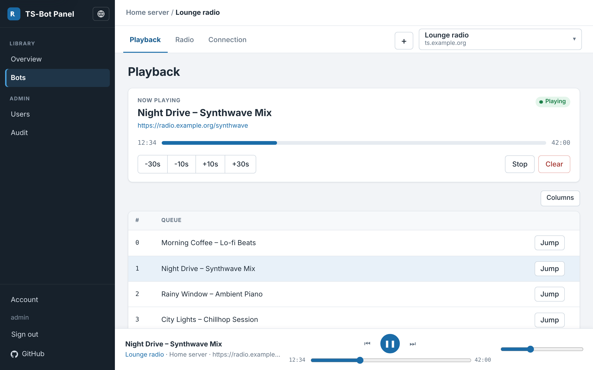

# TS3AudioBot-Docker

A music bot for TeamSpeak 3, ready to run in Docker, with a web panel to control it from the browser.

It packages [TS3AudioBot](https://github.com/Splamy/TS3AudioBot) as a Docker image and adds a panel where you can play music and radio streams, manage several bots, and set up who may use them.



## What you get

- **Playback** in the browser: play, pause, skip, seek, volume, and a queue. The player bar stays at the bottom while you move between pages.
- **Search** YouTube and other sources and add the results to the queue.
- **Radio stations**: save your own stations, or publish them for everyone.
- **Several bots** on one server, each with its own nickname, channel, and stream.
- **Connection settings** in the panel: server address, nickname, default channel, passwords, bitrate, and volume. You do not need to edit config files.
- **Whisper or voice**: play to the whole channel, or only to chosen clients and channels.
- **Accounts**: administrators, users who may create bots, users who only control bots assigned to them, and a bot limit per account.
- **English and German**. The panel follows your browser language, or you can choose one.

## What you need

- A machine with [Docker](https://docs.docker.com/get-docker/) and Docker Compose, on amd64 or arm64 (for example a 64-bit Raspberry Pi OS). The bot alone also runs on 32-bit arm/v7.
- A TeamSpeak 3 server the bot can connect to.
- `git`, or download this repository as a ZIP file.

## Install

1. Get the files:

   ```bash
   git clone https://github.com/CookieCr2nk/TS3AudioBot-Docker.git
   ```

   ```bash
   cd TS3AudioBot-Docker
   ```

2. Create your settings file:

   ```bash
   cp panel/.env.example .env
   ```

3. Open `.env` in a text editor and change these values:

   | Setting | What to enter |
   |---|---|
   | `PANEL_ADMIN_PASSWORD` | The password for the first panel account (`admin`). At least 10 characters. If you leave it empty, the panel writes a random password into its log on the first start. |
   | `PANEL_DB_PASSWORD` | Any long password. Only the panel uses it, so you never type it anywhere else. |
   | `PANEL_DB_ROOT_PASSWORD` | Another long password for the database administrator. |
   | `PANEL_TOKEN_KEY` | A long random text. It encrypts API tokens. You only need one if the bot runs on another machine, but set it now: changing it later makes saved tokens unreadable. |

4. Start everything:

   ```bash
   docker compose -f docker-compose.panel.yml up -d
   ```

   This starts three containers: the bot, the panel, and a database for the panel.

5. Open **http://localhost:8080** (or `http://<your-server>:8080`) and sign in as `admin` with the password from step 3.

## First steps in the panel

1. **Add the bot container.** On **Overview**, press **+**. Give it a name and enter the API address `http://ts3audiobot:58913`. The panel calls this an *instance*: one Docker container that can run several TeamSpeak bots.
2. **Create a bot.** Open the instance and add a bot. The ready-made `default` bot can be attached as well.
3. **Connect to your TeamSpeak server.** Open the bot, go to **Connection**, enter your server address (for example `ts.example.org` or `ts.example.org:9987`), save, and press **Start**.
4. **Set it up.** On the same page, set a nickname, a default channel, passwords if your server needs them, and optionally a radio stream that starts when the bot connects.
5. **Play something.** Go to **Playback**, search for a song or paste a link, and play it. Save streams you use often under **Radio**.

To give other people access, add accounts under **Users** and assign bots to them under **Bots**.

## Everyday use

| Page | What you do there |
|---|---|
| **Overview** | See which instances are online, their TS3AudioBot version, and how many bots run. |
| **Bots** | List of all bots you may open. Select several to start or stop them together. |
| **Playback** | What is playing now, the queue, search, seek, and volume. |
| **Radio** | Your saved stations. Play one now or add it to the queue. |
| **Connection** | Server, nickname, channels, passwords, bitrate, volume, stream on connect, channel commander, and whisper. |
| **Users**, **Audit** | Accounts and a log of who did what. Administrators only. |
| **Account** | Change your own password. |

**Whisper:** On **Connection**, choose **Whisper** to play only to the clients and channels you tick in the lists. Choose **Voice** to play to everyone in the bot's channel.

## Update

```bash
git pull
```

```bash
docker compose -f docker-compose.panel.yml up -d
```

Compose downloads the newest images and restarts what changed. Your bots, settings, accounts, and stations are kept.

## Stop

```bash
docker compose -f docker-compose.panel.yml down
```

This keeps all data. Only `down -v` deletes the stored data as well.

Logs, if something does not work:

```bash
docker compose -f docker-compose.panel.yml logs -f
```

## Troubleshooting

**The instance shows as offline on Overview.** Check that the API address is `http://ts3audiobot:58913` and that the `ts3audiobot` container runs (`docker ps`).

**The bot does not connect.** Check the server address on **Connection**. If the server has a password, enter it there. The bot log shows the reason (`docker compose -f docker-compose.panel.yml logs ts3audiobot`).

**"Missing teamspeak permissions" with a permission name such as `b_client_info_view`.** That is a right on your TeamSpeak server, not a panel error. In TeamSpeak, open *Permissions → Server Groups*, select the group the bot is in (often *Guest*), and grant the named permission. A separate *Bot* server group is cleaner. For the channel and client lists the group also needs `b_virtualserver_channel_list` and `b_virtualserver_client_list`.

**Version shows "Unknown".** The instance is reachable but did not report its version. Update to the newest images.

**Forgot the admin password.** Another administrator can set a new one under **Users**.

## Security

- The bot's control port (58913) is never published to your network. Only the panel can reach it, over an internal Docker network. Because of that the bot accepts every command from the panel without a token.
- **Do not map port 58913 to the host.** Anyone who can reach it could control the bot. If you need that, first remove `isapi = true` from `rights.toml` on the bot volume and use an API token.
- Put the panel behind HTTPS (for example a reverse proxy) if it is reachable from the internet. Then set `PANEL_COOKIE_SECURE=true` and, behind a proxy, `PANEL_TRUST_PROXY=1` in `.env`.
- The bot runs as an unprivileged user with a read-only file system. Details and how to report a problem: [SECURITY.md](SECURITY.md).

## Advanced

### Other setups

There are three Compose files. Each one starts a complete setup on its own.

| File | Starts | Web panel |
|---|---|---|
| `docker-compose.panel.yml` | bot, panel, MariaDB | http://localhost:8080 |
| `docker-compose.panel-external-db.yml` | bot, panel. Uses your own MariaDB | http://localhost:8080 |
| `docker-compose.yml` | bot only | none |

The `Makefile` has short commands for these, for example `make compose-panel-up`, `make compose-panel-down`, and `make compose-panel-logs`.

**Bot only:** `docker compose up -d`. There is no web panel, and the bot's API stays inside the container. Configure the bot in `bots/default/bot.toml` on the data volume.

**Own MariaDB server:** set the connection in `.env` and start with `docker compose -f docker-compose.panel-external-db.yml up -d`.

```bash
PANEL_DB_HOST=db.example.com
PANEL_DB_PORT=3306
PANEL_DB_NAME=ts3panel
PANEL_DB_USER=ts3panel
PANEL_DB_PASSWORD=change-me
```

When MariaDB runs on the same machine as Docker, use `PANEL_DB_HOST=host.docker.internal`, not `127.0.0.1`. The database and user must exist already. The panel creates its tables on the first start and updates them on later starts.

### Other settings in `.env`

| Setting | Default | Meaning |
|---|---|---|
| `PANEL_PORT` | `8080` | Port of the web panel on the host. |
| `PANEL_ADMIN_USER` | `admin` | Name of the first account. |
| `IMAGE_TAG` | `main` | `main` is the stable line. `develop` gets new features first. |
| `PANEL_COOKIE_SECURE` | `false` | `true` when the panel is served over HTTPS. |
| `PANEL_TRUST_PROXY` | `0` | `1` when the panel runs behind a reverse proxy. |

### Where the data lives

- Bot files are in the Docker volume `ts3audiobot-data`, mounted at `/data`. The first start copies the defaults from `config/` into the empty volume. Later image updates do not change it.

  | File on the volume | Contents |
  |---|---|
  | `bots/<name>/bot.toml` | TeamSpeak address, nickname, identity of one bot |
  | `ts3audiobot.toml` | Global defaults, the web API on port 58913 |
  | `rights.toml` | Who may run which commands |

- Accounts, instances, radio stations, and the audit log are in the panel database.
- Passwords for TeamSpeak servers are sent to the bot and are not stored in the panel database.

All bot options: [TS3AudioBot Wiki](https://github.com/Splamy/TS3AudioBot/wiki).

### How accounts and bots relate

An administrator registers each container as an instance and can give it an owner. The owner can create bots on that instance. Every bot can be assigned to one account, which can open and delete it. Other accounts see only bots assigned to them, and can create bots only when an administrator allows it. An administrator can limit how many bots an account may have. Accounts can be suspended, and a new account cannot sign in until it has a password.

## For developers

Rules for code changes, including for AI agents, are in [`AGENTS.md`](AGENTS.md) and [`panel/AGENTS.md`](panel/AGENTS.md). `CLAUDE.md`, `.cursor/rules/project.mdc`, and `.grok/rules/start.md` point there.

**Images.** Published to GHCR as `ghcr.io/cookiecr2nk/ts3audiobot-docker` and `ghcr.io/cookiecr2nk/ts3audiobot-docker-panel`, tagged `:main` from `main` and `:develop` from `develop`. To build them yourself:

```bash
docker build -t ts3audiobot-docker:local .
```

```bash
docker build -t ts3audiobot-panel:local ./panel
```

The bot image builds the `develop` branch of [Splamy/TS3AudioBot](https://github.com/Splamy/TS3AudioBot) (set `BOT_REF` for another ref), because upstream does not publish that build. It runs `dotnet build --framework net10.0 --configuration Release TS3AudioBot` on the .NET 10 SDK and starts `dotnet TS3AudioBot.dll` on `mcr.microsoft.com/dotnet/runtime:10.0`, with ffmpeg, libopus, and `yt-dlp`. It does not include the upstream web interface.

**Panel.** Node.js, Express, MariaDB, and a React UI built with Vite. To work on it, from `panel/`: `npm install`, then `npm start` and `npm run client`, and open `http://127.0.0.1:5173`. `npm run build` writes the files the image serves. To add a language, add `panel/src/locales/<id>.js` and register it in `panel/src/i18n.js`.

**Database changes** are numbered files in `panel/sql/migrations/`. Each runs once and is recorded with a checksum, so an applied file must not change. Statements must be safe to run again.

**Checks.** `make test` and `make panel-test`. CI (`.github/workflows/ci.yml`) also builds both images, starts the stack, and checks that the panel is healthy, reaches the bot API, and that port 58913 is not bound on the host. `.github/workflows/docker-publish.yml` builds the bot for `linux/amd64`, `linux/arm64`, and `linux/arm/v7` and the panel for `linux/amd64` and `linux/arm64`, scans and signs them, pushes them to GHCR, and then deletes old image versions. It keeps `main`, `develop`, `master`, release tags, and the three newest commit tags.

## License

MIT, see [LICENSE](LICENSE). The TS3AudioBot build inside the image is licensed under OSL-3.0.
